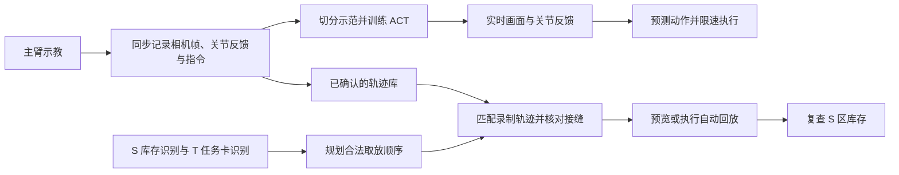

# Koch 机械臂搬运

这个项目用 Koch 机械臂完成两层储存区 **S1–S4** 到两层放置区 **T1–T4** 的方块搬运。它包含主臂示教与单条轨迹回放、基于相机和关节反馈的 ACT 搬运，以及根据库存与任务卡选择录制轨迹的自动回放。当前已完成离线验证。完整自动搬运仍待现场验证。

| 方式 | 输入 | 执行方式 | 入口 |
| --- | --- | --- | --- |
| 手动示教与单条回放 | 人工操作主臂，或选择一条已有记录 | 保存或重放关节目标 | `python collect_koch.py` |
| ACT 搬运 | 实时相机、从臂关节反馈、所选格子和层级 | ACT 预测关节动作，控制器限速并执行 | `python run_koch_skills.py` |
| 自动轨迹回放 | S 区库存、T 区目标卡、示范库 | 先规划取放，再按次序回放记录 | `python -m koch_autonomy replay-ui --site replay-auto.site.json` |
| 离线模拟 | 人工给出的库存和任务 JSON | 计算动作顺序和预期库存变化 | `python -m koch_autonomy demo` |

## 运作思路



### 采集与训练

1. 操作者用主臂示范抓取、搬运、放置和返程。每条记录保存格子、采集时的校准、关节反馈、实际发送的目标以及视频帧时间戳。训练程序用时间戳对齐画面、状态和动作。
2. 四种层级组合分别覆盖 16 条路线，共 64 条。项目原环境积累了 128 条有效示范，四组依次为 31、32、32、33 条。每组训练一个完整搬运模型和 15 个分项模型，另训练了四组合并模型、主动起步模型和去掉开头等待的合并模型。
3. 合并训练先加载 60 个分项模型，用它们给动作片段生成辅助标签。完成预训练后，再用完整示范微调，让模型学习各动作之间怎么衔接。四层级组合共用一个模型，层级由输入条件区分。
4. 去等待版本根据关节实测运动和目标指令共同确认起步位置，仅裁掉示范开头的停顿。它保留主动提臂和随后的搬运过程。原始录像与轨迹继续用于回放。
5. 验证按整条示范划分，避免一段录像的相邻帧同时落入训练与验证。离线指标衡量模型在已有画面下的预测误差。抓放成功率和连续执行效果需要实机统计。

### ACT 推理

ACT 即 Action Chunking with Transformers，是一种用示范学习动作序列的方法。本项目把相机画面转为 RGB 并缩放到 384 × 216，将原始编码器反馈和所选 S/T 条件拼成状态输入。合并模型另接收层级条件。当前运行代码每次取模型动作块的首步，再通过关节控制器限速执行。

执行前会核对导出文件哈希、从臂校准、模型输入输出和示范起点。选定路线后，程序低速对齐该路线的示范起点，等关节反馈到位再交给模型。运行中持续检查反馈、通信和电机状态。ACT 实现和上游说明见 [源码快照](third_party/lerobot_act/)与 [LeRobot ACT 文档](https://huggingface.co/docs/lerobot/en/act)。

### 视觉规划与自动回放

1. **识别 S 区库存**。全局相机用托座外沿校正视角，再分别读取 S1–S4 的上下层。程序结合颜色样本和空台面参考，区分有块、空位和不确定结果。
2. **读取 T 区卡片**。全局相机画面先按配置转正，再找四角的彩纸并提取颜色和数字。两个数字 CNN 用于主识别与复核，结果还要通过连续帧稳定检查。数量可按奇偶解读，或直接读取 0–2 块。
3. **计算取放顺序**。规划器按库存从上层取料，按目标从下层放置。它只在可执行的库存状态之间搜索，成本默认按布局距离估算。颜色不足、上层遮挡或任务量无法同时满足并清空 S 区时，流程会在启动阶段报错。
4. **绑定与校验**。以 S/T 格子和层级选择已确认的示范。程序比较相邻轨迹末端与下一条起点，尝试匹配兼容版本。无法满足 10° 起点容差时会停止准备，不连接从臂。
5. **执行与复查**。已确认的计划使用原回放控制器限速执行。整组轨迹执行完后重读 S 区库存。T 区落点、抓取是否成功以及过程碰撞仍需单独验证。

## 快速开始

需要 Python 3.12。以下指令在仓库根目录执行，使用已激活的环境。离线规划和模拟不需要相机或串口。

```powershell
python -m pip install -r requirements.txt
python -m koch_autonomy plan --input examples/task.example.json --output outputs/plan.json
python -m koch_autonomy demo
python -m unittest test_koch_autonomy test_koch_replay_auto test_koch_capture_policy -q
```

原环境版本记录见 [原环境版本.json](原环境版本.json)。运行 ACT 另需安装完整的 LeRobot，旧权重优先用原环境版本核对兼容性。仓库里的 ACT 快照可供阅读。当前相机枚举和实机入口以 Windows 为主。按设备名称枚举相机需要可用的 FFmpeg DirectShow。Tkinter 窗口需要 Python 的 Tk 支持，调用 OpenCV 原生窗口或交互选区时需要支持 HighGUI 的 OpenCV 环境。

### 现场运行入口

```powershell
# 已放入现场示范后，只检查轨迹文件和层级覆盖
python -m koch_autonomy replay-audit --data datasets

# 使用已有模型包打开 ACT 窗口
python run_koch_skills.py

# 查看第一层 S → 第一层 T 的采集进度
python collect_koch.py --output datasets/koch_st --list

# 读相机和检查整组路线接缝，不连接从臂
python -m koch_autonomy replay-auto --site replay-auto.site.json --preview

# 打开自动搬运界面，初始状态不执行动作
python -m koch_autonomy replay-ui --site replay-auto.site.json
```

从 [现场配置示例](replay-auto.site.example.json) 复制本机配置。根据 [自动搬运回放说明](docs/自动搬运回放.md) 填写现场相机、标定、目标卡、数据目录和从臂串口。需要运行数字识别时，按 [T 区视觉配置示例](configs/grid_runtime.example.json) 指向两份实际权重。示例相机编号、路径和角度是待替换的值。

换电脑时保留项目相对目录结构。ACT 读取本地清单和检查点里的项目相对路径，现场配置里资源路径从配置文件所在目录解析。恢复 ACT 推理需要对应的 `manifest.json`、模型索引、导出权重、示范元数据与起点参考，以及录制时对应的从臂校准文件。运行界面探针 `--probe` 或重训视觉模型，还需要配套录像或图像缓存。

### 恢复训练与查看进度

先恢复采集数据、录像或训练缓存，以及原数据筛选清单。合并训练需要 CUDA GPU。下列路径可替换成实际批次目录，运行合并训练前应确认四组的 64 个模型都已导出。

```powershell
python train_koch_layers.py --batch outputs/koch_layers/batch_01
python train_koch_merged.py --batch outputs/koch_layers/batch_01 --output outputs/koch_merged/batch_01
python visualize_koch_training.py --batch outputs/koch_layers/batch_01
```

主动起步训练会从 `outputs/koch_layers/latest_batch.json` 的 `batch` 和 `outputs/koch_merged/latest_batch.json` 的 `output` 读取前两阶段的目录。迁移已有批次时，连同这两个索引一并恢复。使用上面的新批次目录时，把两个索引分别指向 `./outputs/koch_layers/batch_01` 和 `./outputs/koch_merged/batch_01`，再运行 `python train_koch_active.py --output outputs/koch_active/batch_01`。各阶段在 `queue_state.json` 写入进度与失败原因，训练可视化从这些记录读取状态。

## 当前解决和待解决的问题

| 问题 | 当前处理 | 验证状态 |
| --- | --- | --- |
| 模型启动时去错姿态 | 用所选路线的示范起点做自动对齐。单独回休息位仍使用休息姿态。 | 已离线复现并验证。 |
| 模型反复停在示范开头 | 分出主动起步并重训无等待合并模型。4 条留出示范上，起步前 0.8 秒的肩肘平均误差从 6.87° 降到 3.77°。 | 离线误差降低。新模型的实机起步成功率待测。 |
| 采集与回放数据容易混用 | 保留原始示范、训练副本和运行日志各自的目录。回放按路线、层级、完成标记和校准核对数据。 | 现有 128 条示范通过轨迹审计。 |
| 换电脑找不到文件 | 训练清单保存项目相对路径，视觉现场配置独立处理。启动命令由本机 Python 环境执行。 | 已在含中文和空格的其他目录验证。 |
| 录制轨迹接不上 | 执行前比较示范接缝并择选可用版本。已知 S4→T4（2→1）接 S4→T3（1→1）的最小差值仍为 10.90°。 | 会在连接机械臂前拒绝该接缝。对应记录需要复核或重录。 |
| 识别随设备与光照变化 | 保留分区标定、空台面参考、方向检查和连续帧确认。 | 已有离线样例。新视角、光照和摆场需要重新验证。 |
| 整段避碰、抓放与放置闭环 | 现阶段有接缝和电机保护，整组执行后确认 S 区是否清空。 | 三维避碰、单步抓放验证、T 区落点与全流程实机成功率仍待补齐。 |
| 独立复现训练 | 提供数据准备、训练、验证与导出源码。 | 标准四组训练入口仍引用原数据批次的清理清单。用新数据重训前需要准备相同格式的清单，并核对日期筛选规则。 |

## 目录和提交内容

| 位置 | 说明 |
| --- | --- |
| [koch_autonomy/](koch_autonomy/) | 视觉、库存规划、自动回放面板、轨迹绑定和模拟 |
| [koch_skill_runtime.py](koch_skill_runtime.py)、[run_koch_skills.py](run_koch_skills.py) | ACT 加载、实时输入与推理界面 |
| [collect_koch.py](collect_koch.py)、[koch_dataset.py](koch_dataset.py) | 手动采集、数据格式、单条轨迹回放 |
| [teleoperate_koch.py](teleoperate_koch.py)、[koch_teleop_bus.py](koch_teleop_bus.py) | 串口控制、反馈检查和扭矩释放 |
| [train_koch_layers.py](train_koch_layers.py)、[train_koch_merged.py](train_koch_merged.py)、[train_koch_active.py](train_koch_active.py) | 分层训练、合并训练与主动起步训练 |
| [grid_reader/](grid_reader/)、[handwritten_digits/](handwritten_digits/) | 颜色区域、数字裁切与 CNN 推理 |
| [configs/](configs/)、[examples/](examples/) | 示例配置与无需硬件的任务输入 |
| [third_party/lerobot_act/](third_party/lerobot_act/) | ACT 源码快照、来源和许可证 |

仓库提交源码、配置示例、文档和离线测试。`datasets/`、`outputs/`、机械臂校准、现场配置和模型权重应由各环境单独管理，已列入 [Git 忽略清单](.gitignore)。LeRobot 快照保留其 [原始许可证](third_party/lerobot_act/LICENSE)。
